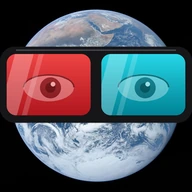

# Fijerena

<div align="center">



**A media player for Android TV and Android phones: IPTV (Xtream Codes, M3U) and Jellyfin**

[](LICENSE)
[](#requirements)
[](https://kotlinlang.org)

</div>

---

## What it is

Fijerena is a free and open-source media player. One codebase builds two apps: a 10-foot app for
Android TV driven by the remote's D-pad, and a touch app for phones. Both play Live TV, films and TV
shows from the sources **you** add, with a TV guide, profiles, and optional live sync between your
own devices.

## What it isn't

**Fijerena does not provide or host any content.** It ships with no channels, playlists, films or
subscriptions, and it doesn't recommend any. You need your own source: a Jellyfin server, an IPTV
subscription you are entitled to use (Xtream Codes login or M3U playlist link), or a playlist you
made yourself.

## Requirements

- **Android 11 or later** (API 30), on both TV and phone. Many devices fall short of that: most
  inexpensive Android TV boxes still on Android 9 or 10, and Amazon Fire TV devices on Fire OS 7
  or older, can't install it.
- Tested on Android phones, NVIDIA Shield (Shield TV and Shield TV Pro), Chromecast with Google TV,
  and Sony Bravia Android TVs.
- An ARM device (arm64-v8a or armeabi-v7a), as almost every TV and phone is.

## Install

Signed APKs are on this repository's [GitHub Releases](https://github.com/mpilasy/fijerena/releases)
page; F-Droid is planned from version 1.0. Or build it from source (see [Building](#building)).

The TV app and the phone app are separate APKs: install the TV one on a TV and the phone one on a
phone.

## Features

The full reference is **[docs/FEATURES.md](docs/FEATURES.md)**; this is the short version.

- **Sources:** Xtream Codes (Live TV, Movies, TV Shows, guide), Jellyfin (Movies, TV Shows, progress
  sync, Quick Connect), and Remote M3U playlists (Live TV and the playlist's video entries). Several
  sources can be configured; logins are stored encrypted on the device.
- **Live TV:** a channel plays beside the list while you browse; a channel panel (category, Recent,
  Favourites) in the preview and over the video in full screen; channel switching with Up/Down; a TV
  Guide grid and guide search over XMLTV guides, refreshed in the background.
- **Movies and TV Shows:** details screens, resume, Continue Watching and Up next, mark
  watched/unwatched, and extra details from TMDB with your own free TMDB key, entered in Settings.
- **Player:** Media3 (HLS, DASH, MPEG-TS) with the FFmpeg decoder extension; audio, subtitle and quality
  selection remembered per item and per series, Stats for Nerds, network-aware buffering.
- **Profiles and live sync:** a "Who's watching?" picker with per-profile favourites, history and
  filters; profiles, favourites, progress and settings kept in step across your devices, end-to-end
  encrypted, through a sync server you host yourself ([server/](server/README.md)); TVs join by QR
  code from a phone.
- **Settings:** colour themes and looks per profile, an optional profile PIN, English, French and
  Malagasy, UI scale on TV, backup and restore to a file.

## Privacy

No analytics, no ads, no crash upload. Logins stay on the device, encrypted. The app talks only to
the sources and guide links you add (and the stream and image addresses they list), to TMDB if you
configure a key, and to a sync server if you set one up; sync data is end-to-end encrypted before it
leaves the device. The camera is used only to
scan a pairing QR code on the phone. Android backup and device transfer are off; move to a new device
with Export / Import or live sync. The details are in [PRIVACY.md](PRIVACY.md).

## Terms of use

Fijerena provides no content and comes with no sources. You alone are responsible for the sources
you add and for making sure that your use of them is legal where you are. The full terms are in
[TERMS.md](TERMS.md) and in the app, Settings → About → Terms of use.

---

## For developers

### Building

Prerequisites: **JDK 21**, the **Android SDK** (API level 36), and optionally Android Studio (a
release that supports AGP 9.4).

```bash
git clone https://github.com/mpilasy/fijerena.git
cd fijerena
./gradlew assembleDebug            # both apps
./gradlew :tv:assembleDebug        # TV only   (or scripts/build-tv.sh)
./gradlew :mobile:assembleDebug    # phone only (or scripts/build-mobile.sh)
```

Outputs: `tv/build/outputs/apk/debug/tv-debug.apk` and
`mobile/build/outputs/apk/debug/mobile-debug.apk`. Debug builds also include x86 and x86_64 so
emulators run natively.

Nothing is required to build, and no build carries a TMDB key. For TMDB details, enter your own key
(v3 API key or v4 read access token, free from themoviedb.org → Settings → API) in the app:
Settings → Sources & guide → Film and series details (TMDB). Without one, nothing is sent to TMDB.

`./gradlew :tv:assembleRelease` and `:mobile:assembleRelease` build release APKs, signed when the
`FIJERENA_*` signing variables or a `keystore.properties` provide a key, unsigned otherwise (see
[docs/RUN_GUIDE.md](docs/RUN_GUIDE.md) → Releasing).

### Installing a development build

The deploy scripts build the right APK and install it as an update:

```bash
scripts/deploy-tv-emulator.sh [serial]       # TV emulator
scripts/deploy-mobile-emulator.sh [serial]   # phone emulator
scripts/deploy-tv-ip.sh <ip>[:port] ...      # network TVs
scripts/deploy-mobile-usb.sh [serial]        # phone over USB
```

The TV app is `org.njarasoa.fijerena` and the phone app `org.njarasoa.fijerena.mobile`, so one
APK never replaces the other. `adb install -r` can wipe the app's data without warning; the real-device
scripts back up user data first (`scripts/backup-app-data.sh`, which needs `sqlite3` on the host).
Device discovery, backup/restore, logs and debugging are in
**[docs/RUN_GUIDE.md](docs/RUN_GUIDE.md)**.

### Checks

```bash
./gradlew ktlintCheck          # code style (ktlintFormat fixes it)
./gradlew lintDebug            # Android Lint; each module's lint-baseline.xml holds the old warnings
./gradlew testDebugUnitTest    # unit tests
scripts/check-cancellation.sh && scripts/check-viewmodel-launch.sh && scripts/check-focus-retry.sh
scripts/check-design-system.sh
```

GitHub Actions runs these on every push to `main`: `checks.yml` (the gates), `android-build.yml`
(tests, lint, the Room schema check, both debug APKs) and `server.yml` (the sync server's tests,
when `server/` changes).

```bash
# Instrumentation tests (requires a connected device/emulator).
# WARNING: this uninstalls the app and wipes its data on EVERY connected device;
# disconnect real devices first, or target one emulator with ANDROID_SERIAL.
./gradlew connectedAndroidTest
```

### Tech stack

| Component | Technology | Version |
|-----------|-----------|---------|
| Language | Kotlin | 2.3.0 |
| Build System | Gradle | 9.6.0 |
| Build System | Android Gradle Plugin (AGP) | 9.4.1 |
| UI Framework | Jetpack Compose | 2026.03.01 BOM (ui/foundation/runtime/animation 1.10.6) |
| Material Design | Material 3 | 1.4.0 (`strictly`) |
| TV Components | androidx.tv.material3 (lists are plain LazyColumn/LazyRow) | 1.0.0-alpha10 |
| Video Player | Media3 (ExoPlayer), Jellyfin FFmpeg decoder | 1.8.0 |
| Trailer Player | android-youtube-player (YouTube's embedded player in the system WebView, MIT) | 13.0.0 |
| Networking | Ktor (OkHttp engine) | 3.5.2 |
| Serialization | kotlinx.serialization | 1.11.0 |
| Database | Room (FTS4) | 2.8.4 |
| SQLite | Bundled requery build (FTS5 capable) | 3.49.0 |
| Background Work | WorkManager | 2.11.2 |
| Paging | androidx.paging | 3.5.1 |
| Image Loading | Coil | 3.5.0 |
| Navigation | Navigation Compose | 2.8.5 |
| Coroutines | kotlinx.coroutines | 1.11.0 |
| SMB Client | smbj (Hierynomus) | 0.15.0 |
| Sync server | TypeScript on Cloudflare Workers / workerd | see `server/package.json` |

`gradle/libs.versions.toml` is authoritative. Minimum SDK 30 (Android 11), target SDK 35, compile
SDK 36; release ABIs arm64-v8a and armeabi-v7a.

Architecture in one line: multi-module MVVM (ViewModel + StateFlow), provider types mapped to shared
domain models, one `MediaRepository` per source, manual DI through `AppContainer`. See
[docs/design.md](docs/design.md).

### Project structure

```
fijerena/
├── mobile/                    # Phone app (touch UI)
├── tv/                        # Android TV app (10-foot UI)
├── core/
│   ├── player/               # Media3 player, playback service, domain models, diagnostics
│   ├── network/              # Source implementations, Room databases, EPG pipeline, live sync client
│   ├── ui/                   # Shared ViewModels, Compose components, design tokens, strings
│   └── navigation/           # Type-safe navigation definitions
├── server/                   # Live sync server (Cloudflare Worker / workerd Docker image)
├── scripts/                  # Build, deploy, backup/restore, CI checks, TV focus walks
├── tools/jellyfin-xtream/    # Development only: serves a Jellyfin library as an Xtream panel for testing
├── docs/                     # Technical documentation
└── CONTRIBUTING.md                 # Coding rules and conventions
```

### Documentation

- **[docs/FEATURES.md](docs/FEATURES.md)** - Feature reference, settings, themes
- **[docs/design.md](docs/design.md)** - System design and architecture
- **[docs/NAVIGATION_GUIDE.md](docs/NAVIGATION_GUIDE.md)** - Screens, navigation flow, TV focus handling
- **[docs/DATABASE_SCHEMA.md](docs/DATABASE_SCHEMA.md)** - Room databases and SharedPreferences
- **[docs/epg_guide.md](docs/epg_guide.md)** - EPG pipeline implementation guide
- **[docs/EPG_INDEX_STORAGE.md](docs/EPG_INDEX_STORAGE.md)** - Why the EPG index grew to 87% dead space, and how to read DB state from a file header
- **[docs/RUN_GUIDE.md](docs/RUN_GUIDE.md)** - Build, install, deploy, backup/restore, debugging, focus walks
- **[docs/RELEASE_NOTES.md](docs/RELEASE_NOTES.md)** - Changelog
- **[server/README.md](server/README.md)** - Live sync server: develop, deploy, self-host, API

### Contributing

1. Read [CONTRIBUTING.md](CONTRIBUTING.md) for the coding rules (design tokens, TV focus, strings in English,
   French and Malagasy, database migrations).
2. Work on a branch.
3. Keep TV screens D-pad navigable and inside the safe margins; use the design tokens.
4. Make ktlint, Android Lint, the unit tests and the `scripts/check-*.sh` gates pass.
5. Test on both TV and phone; include screenshots or recordings for UI changes.
6. Write commit messages that say why, not only what.

7. Sign off each commit (`git commit -s`) to certify the [Developer Certificate of Origin](DCO).

By contributing you agree that your contribution is licensed under the project's licence (below).

## License

Copyright © 2026 Orinasa Njarasoa

The Android apps (`tv/`, `mobile/`, `core/`) are free software: you can redistribute and/or modify
them under the terms of the **GNU General Public License, version 3 or (at your option) any later
version** ([GPL-3.0-or-later](LICENSE)). The sync server in `server/` is licensed under the **GNU
Affero General Public License, version 3 or later** ([AGPL-3.0-or-later](server/LICENSE)).

This program is distributed in the hope that it will be useful, but WITHOUT ANY WARRANTY; without
even the implied warranty of MERCHANTABILITY or FITNESS FOR A PARTICULAR PURPOSE. See the licences
for details.

### Artwork and fonts

- **App icon and logo** (`mobile/src/main/res/drawable-*/ic_launcher_foreground.png`, the
  `ic_launcher*.webp` mipmaps of both apps, `core/ui/src/main/res/drawable-*/app_logo.png`): the
  Earth is "The Blue Marble", photographed by the crew of Apollo 17 on 7 December 1972 (NASA photo
  AS17-148-22727), which is in the public domain as a work of NASA. The red/cyan 3D glasses drawn
  over it: **source and licence still to be recorded.**
- **Manrope** (`tv/` and `mobile/` `res/font/manrope_variable.ttf`): Copyright 2019 The Manrope
  Project Authors, licensed under the SIL Open Font License 1.1
  ([docs/licenses/Manrope-OFL.txt](docs/licenses/Manrope-OFL.txt)).

## Acknowledgments

- **Jetpack Compose** - declarative UI toolkit
- **Media3** - the ExoPlayer playback engine, and Jellyfin's FFmpeg decoder build
- **Ktor** - networking
- **android-youtube-player** (Pierfrancesco Soffritti) - plays trailers in the app
- **Hierynomus** - the smbj SMB client library
- The open-source libraries listed in `gradle/libs.versions.toml`
