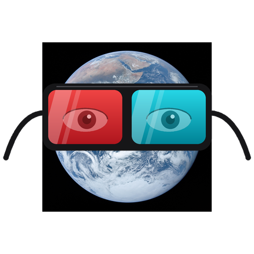

# Fijerena

**Watch Live TV, films and TV shows from your own sources, on your Android TV and your phone.**

Free and open source. No ads, no tracking, no account.

<table>
  <tr>
    <td align="center"> <b>Phone app</b></td>
    <td align="center"> <b>TV app</b></td>
  </tr>
</table>

---

## What You Get

- **Live TV with a guide.** Browse channels while one plays beside the list. See what is on now and
  next, and search the guide.
- **Films and TV shows.** Resume where you stopped, Continue Watching, Up Next, and posters and
  details from TMDB (with your own free TMDB key).
- **A TV app made for the remote** and **a phone app made for touch.** Both come from the same
  project and work the same way.
- **Profiles for the whole household,** each with its own favourites, history and filters, and an
  optional PIN.
- **Sports.** Follow teams and leagues, see their next games and results, find the channels that
  show them, and get a reminder before a game starts.
- **Your devices in step.** Optional live sync keeps profiles, favourites and progress the same on
  all your devices. It is end-to-end encrypted, through a sync server that you host yourself.
- **Send to TV.** Pick a film, an episode or a channel on your phone and play it on your TV.
- **English, French and Malagasy,** colour themes and looks for each profile.

## Before You Start: Bring Your Own Source

**Fijerena does not provide or host any content.** It comes with no channels, playlists, films or
subscriptions, and it does not recommend any. You need one of these:

- A **Jellyfin** server (films and TV shows).
- An **IPTV service** that you have the right to use, with an **Xtream Codes** login (Live TV,
  films, TV shows and the guide) or an **M3U playlist** link.

You alone are responsible for the sources you add (see [Terms of Use](#terms-of-use)).

## Install

There are two apps. Install the **TV app** on a TV or TV box, and the **phone app** on a phone.

### With Obtainium (recommended: it keeps the app up to date)

[Obtainium](https://github.com/ImranR98/Obtainium) installs apps from their GitHub releases and
tells you when there is an update.

- **On a phone:** install Obtainium, then tap the **Phone app** button above.
- **On a TV:** install Obtainium on the TV, then add the app by hand: **Add App**, the address
  `https://github.com/mpilasy/fijerena`, and in **APK filter** type `fijerena-tv`.
  (On a phone, the **TV app** button does the same.)

### From GitHub

1. Open the [latest release](https://github.com/mpilasy/fijerena/releases/latest).
2. Download `fijerena-phone-….apk` for a phone, or `fijerena-tv-….apk` for a TV.
3. Open the file and allow your browser or file manager to install apps when Android asks.

On a TV, the easiest way is often a downloader app on the TV, or a file manager that opens the APK
from a USB stick or a network folder.

F-Droid is planned from version 1.0.

## Getting Started

1. Open Fijerena. The first time, it opens **Add Source**.
2. Choose the type (**Xtream IPTV**, **Jellyfin** or **Remote M3U**) and enter the address and the
   login from your provider. The app checks the login before it saves the source.
3. Wait a moment while the app loads your channels, films and shows. A large guide can take a few
   minutes the first time.
4. Watch. On TV, use the arrow keys and OK. On the phone, tap.

The **[User Guide](docs/USER_GUIDE.md)** shows the rest: profiles, the guide, sports, live sync,
Send to TV and backups.

## Will It Run on My Device?

| | Minimum | Recommended |
|---|---|---|
| **Android** | 11 (TV and phone) | |
| **Memory** | 1.5 GB | 3 GB or more |
| **Free storage** | 1.5 GB | 3 GB or more |
| **Network** | Wi-Fi 5 for HD | Ethernet or Wi-Fi 6 for 4K |

- **Tested on:** Android phones, NVIDIA Shield TV and Shield TV Pro, Chromecast with Google TV HD,
  and Sony Bravia Android TVs.
- **Will not install on:** many low-cost TV boxes that still run Android 9 or 10, Amazon Fire TV
  devices on Fire OS 7 or older, and Fire TV devices on Vega OS (they are not Android).
- With less than 3 GB of memory the app works, but a large guide loads more slowly, and Android
  closes the app in the background sooner.
- The app is about 100 MB. Your catalogue and guide need from a few hundred MB to more than 1 GB.

## Privacy

No analytics, no ads, no crash upload, and no account with us. Your logins stay on your device,
encrypted. The app talks only to the sources you add, and to TMDB, the sports services or YouTube
when you use those features. Live sync is end-to-end encrypted. The details are in
[PRIVACY.md](PRIVACY.md).

## Terms of Use

Fijerena provides no content and comes with no sources. You alone are responsible for the sources
you add and for making sure that your use of them is legal where you are. The full terms are in
[TERMS.md](TERMS.md), and in the app: Settings → About → About Fijerena → Terms of Use.

## Help and More

- **[User Guide](docs/USER_GUIDE.md):** how to use the apps.
- **[Release notes](docs/RELEASE_NOTES.md):** what changed in each version.
- **[Feature reference](docs/FEATURES.md):** every feature in full detail.
- **[Sync server](server/README.md):** how to host your own live sync server.
- **Found a problem or have an idea?** [Open an issue](https://github.com/mpilasy/fijerena/issues).

## For Developers

To build the apps, run the checks or contribute, see **[docs/DEVELOPING.md](docs/DEVELOPING.md)**
and [CONTRIBUTING.md](CONTRIBUTING.md).

## License

Copyright © 2026 Orinasa Njarasoa

The Android apps (`tv/`, `mobile/`, `core/`) are free software: you can redistribute and/or modify
them under the terms of the **GNU General Public License, version 3 or (at your option) any later
version** ([GPL-3.0-or-later](LICENSE)). The sync server in `server/` is licensed under the **GNU
Affero General Public License, version 3 or later** ([AGPL-3.0-or-later](server/LICENSE)).

The APKs also contain Jellyfin's FFmpeg decoder, which is licensed under the GPL version 3 only.
An APK as a whole can therefore be passed on only under the GPL version 3; the project's own code
stays GPL-3.0-or-later. Settings → About → About Fijerena → Open-Source Licences lists every
library in the APK with its licence, among them FFmpeg (LGPL-2.1-or-later, inside the decoder) and
the Public Suffix List (MPL-2.0, bundled by OkHttp).

This program is distributed in the hope that it will be useful, but WITHOUT ANY WARRANTY; without
even the implied warranty of MERCHANTABILITY or FITNESS FOR A PARTICULAR PURPOSE. See the licences
for details.

### Artwork and Fonts

- **App icon and logo** (`mobile/src/main/res/drawable-*/ic_launcher_foreground.png`, the
  `ic_launcher*.webp` mipmaps of both apps, `core/ui/src/main/res/drawable-*/app_logo.png`): the
  Earth is "The Blue Marble", photographed by the crew of Apollo 17 on 7 December 1972 (NASA photo
  AS17-148-22727), which is in the public domain as a work of NASA. The red/cyan 3D glasses over
  it were drawn for this project (2026-10-26) and are licensed with the app under
  GPL-3.0-or-later.
- **Manrope** (`tv/` and `mobile/` `res/font/manrope_variable.ttf`): Copyright 2018 The Manrope
  Project Authors, licensed under the SIL Open Font License 1.1
  ([licenses/fonts/manrope-OFL.txt](licenses/fonts/manrope-OFL.txt)).
- **Look and Feel fonts** (`core/ui/src/main/res/font/`): Antonio, Barlow, Barlow Condensed,
  IBM Plex Sans, Inter, Klee One, Lexend, Manrope, Nunito, Source Serif 4, Space Grotesk and
  Zen Maru Gothic, each licensed under the SIL Open Font License 1.1
  ([licenses/fonts/](licenses/fonts/)).

## Acknowledgments

- **Jetpack Compose** - declarative UI toolkit
- **Media3** - the ExoPlayer playback engine, and Jellyfin's FFmpeg decoder build
- **Ktor** - networking
- **android-youtube-player** (Pierfrancesco Soffritti) - plays trailers in the app
- **Hierynomus** - the smbj SMB client library
- The open-source libraries listed in `gradle/libs.versions.toml`
