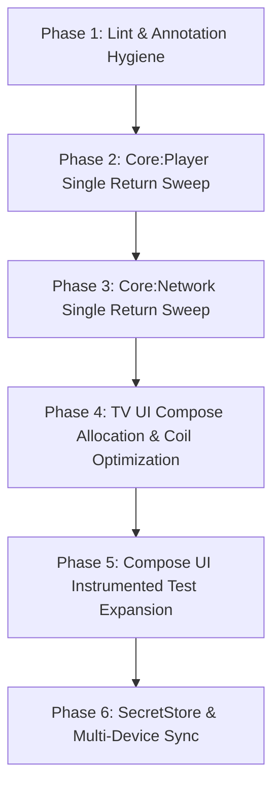

# Codebase Robustness & Technical Debt Plan

**Status:** Phase 1 landed 2026-09-29 (`3e78292f`); Phases 2-3 (single-return sweeps) dropped by the user 2026-10-03, the AGENTS.md rule stays for new code; Phase 4 done 2026-10-12: measured on darcy and mdarcy; the cost was accessibility semantics (darcy runs Button Mapper), fixed by one node per channel row (36% → 20% janky frames); Phase 5 in progress (started 2026-10-12) Phase 5 as Robolectric Compose tests on the JVM (user decision: `connectedAndroidTest` uninstalls the app and wipes the device's data). Phase 6: live sync is now complete (`20260929_live-sync-plan.md`), secret-store migration still deferred.  
**Date:** 2026-09-14  
**Scope:** Full codebase review (`core:player`, `core:network`, `core:ui`, `core:data`, `core:navigation`, `tv`, `mobile`)

---

## 1. Executive Summary & Verification Baseline

An empirical evaluation of the Fijerena codebase was conducted on 2026-09-14 to establish an objective robustness baseline following multiple audit and remediation cycles:

- **Build Integrity:** `./gradlew assembleDebug` compiles cleanly in ~12 seconds with AGP 9.4.0 and Gradle 9.6.0.
- **Style & Formatting:** `./gradlew ktlintCheck` passes cleanly across all 7 modules with zero violations.
- **Unit Test Suite:** 193 unit tests pass across all modules (`0 failures, 0 skipped, 0 errors`).
- **Remediation Milestones:** 
  - 29/29 issues resolved from [`20260824_codebase-audit-fix-plan.md`](file://docs/plans/archive/20260824_codebase-audit-fix-plan.md).
  - All verified findings from [`20260912_adversarial-codebase-remediation-plan.md`](file://docs/plans/archive/20260912_adversarial-codebase-remediation-plan.md) and [`20260912_adversarial-codebase-review-round2-plan.md`](file://docs/plans/archive/20260912_adversarial-codebase-review-round2-plan.md) applied.

### Core Robustness Pillars

| Pillar | State | Mechanism |
|--------|-------|-----------|
| **Data Durability** | Production-Grade | Room tables `watch_state` (v15/v17) and `favorite_state` (v16) in `xtream_v2.db` eliminate legacy SharedPreferences JSON blob truncation. Sticky completion (`MAX(existing, new)`) protects watched state. Two-level TMDB deduplication links variants by series-level TMDB ID and `(season, episodeNum)`. |
| **Concurrency & Thread Safety** | Hardened | Swallowed `CancellationException` hazards removed from `Result.kt`, `EpgFileManager.kt`, and `JellyfinApiService.kt`. Explicit `Closeable` on `MediaRepository` shuts down `HandlerThread` and cancels `writeScope`. SMB file handle leaks closed via `SmbFileInputStream`. |
| **Playback & Hardware** | High | Sony Bravia and HEVC-only TV chipsets correctly detect 4K via `supportsHevc || supportsAv1`. Hot-swapped `AdaptiveLoadControl` replays onto ExoPlayer playback thread. Session finalization awaited on back navigation. |
| **EPG Pipeline** | High | Conditional HTTP requests (`ETag`, `Last-Modified`) + SHA-256 payload checksums skip unchanged sources within 24h. Atomic FTS4 staging table swaps and Room recreation prevent table locks. |

---

## 2. Technical Debt & Fragility Areas

Despite high resilience in core layers, five areas of technical debt and fragility remain:

1. **Android TV UI Recomposition & GC Pressure:**
   - Navigating to large Live TV categories induces background GC pauses and main-thread layout spikes on memory-constrained hardware (NVIDIA Shield). Magnitude not yet profiled — needs a Perfetto/systrace capture before scoping a fix.
   - Rapid channel logo loading triggers `DiskLruCache` worker thread lock contention in Coil.
   - Screen re-entry from player on mobile exhibits an unexplained recomposition frame drop. Needs profiling to quantify.
2. **Lint & API Opt-In Warnings:**
   - Unannotated Media3 `@UnstableApi` usages in `FijerenaApplication.kt` block strict `./gradlew lintDebug`.
3. **Single Return Statement Compliance:**
   - Completed and verified across `core:ui`, `tv`, and `mobile`.
   - Remaining multi-return functions pending in `core:player` (~33 functions) and `core:network` (~145 functions).
4. **Test Coverage Asymmetry:**
   - High automated test coverage for domain logic, database operations, and parsers (193 tests).
   - Minimal automated Compose UI and navigation test coverage (currently limited to `EpisodeSelectionScreenTest` in `:tv`).
5. **Upstream Security Deprecation & Multi-Device Sync:**
   - `androidx.security:security-crypto` is deprecated upstream; owned Keystore replacement documented in [`20260828_secret-store-migration-plan.md`](file://docs/plans/20260828_secret-store-migration-plan.md) is deferred.
   - Xtream user state remains device-local; multi-device synchronization is planned in [`20260929_live-sync-plan.md`](file://docs/plans/archive/20260929_live-sync-plan.md) but not started.

---

## 3. Phased Remediation Roadmap

### Phase 1: Lint & Annotation Hygiene (P0 - Immediate)
- **Goal:** Ensure `./gradlew lintDebug` passes with zero errors.
- **Tasks:**
  1. In [`FijerenaApplication.kt`](file://core/ui/src/main/java/org/njarasoa/fijerena/core/ui/FijerenaApplication.kt), add `@OptIn(androidx.media3.common.util.UnstableApi::class)` where `StreamingPlaybackService` playback state is checked.
  2. Verify `./gradlew lintDebug` passes across all modules.

### Phase 2: Single Return Statement Sweep in `core:player` (P1) — dropped 2026-10-03
- **Goal:** Enforce the project's single return statement rule across all methods in `core:player`.
- **Tasks:**
  1. Audit ~33 candidate functions identified by heuristic scan.
  2. Refactor each function to use a single exit point with immutable/accumulator return assignments.
  3. Verify with `./gradlew :core:player:testDebugUnitTest` and `./gradlew assembleDebug`.

### Phase 3: Single Return Statement Sweep in `core:network` (P2) — dropped 2026-10-03
- **Goal:** Complete the single return refactoring across `core:network`.
- **Tasks:**
  1. Audit candidate functions in DAOs, API clients, and repositories.
  2. Refactor while preserving coroutine cancellation propagation (`if (e is CancellationException) throw e`).
  3. Verify with `./gradlew :core:network:testDebugUnitTest`.

### Phase 4: Android TV UI Compose Allocations & Image Contention (P2) — done 2026-10-12 (measured; the fix was the rows' semantics, not allocations)
- **Goal:** Mitigate GC spikes during category browsing on Android TV.
- **Tasks:**
  1. Hoist allocations out of composables in `tv/.../feature/category/` and `tv/.../feature/livetv/`.
  2. Profile Coil channel logo loading under `Dispatchers.IO` to reduce `DiskLruCache` worker lock contention.
  3. Validate against measured baselines on hardware (NVIDIA Shield / Sony Bravia).

#### Phase 4 measurement (2026-10-12, darcy, debug build)

Live TV, bears, category "US| ESPN+ PPV VIP" (1,000 channels): D-pad down through the channel list
(60 single presses, then 250 queued), `dumpsys gfxinfo` and a Perfetto trace (atrace gfx, view,
dalvik, input; sched).

- **Frames:** 2,292 frames, 36% janky, 90th percentile 46 ms, 99th 77 ms; 414 frames late from
  the UI thread. Walking the category list: 24% janky, 90th 20 ms. Idle: no frames drawn.
- **GC is not the problem:** 25 background young collections (1.0 s in all, longest 49 ms) and one
  full concurrent one (296 ms), all on `HeapTaskDaemon`, concurrent with the UI thread.
- **Accessibility semantics is the biggest cost:** darcy runs Button Mapper
  (`flar2.homebutton`), an accessibility service that listens for window content changes; mdarcy
  has none. With any such service on, Compose diffs the whole semantics tree:
  `getAllUncoveredSemanticsNodesToIntObjectMap` 7.5 s, `checkForSemanticsChanges` 5.9 s,
  `sendAccessibilitySemanticsStructureChangeEvents` 5.1 s on the UI thread over the run. 113 of
  the 208 frames over 16.7 ms would have been on time without it.
- **The rest of a slow frame** (avg 23 ms): semantics 5.6 ms, layout 5.4 ms, draw 4.0 ms,
  recomposition 2.9 ms; `FocusOwnerImpl:dispatchKeyEvent` 2.2 s in all.
- **The same run on mdarcy** (same model and build, no accessibility service, profile atr): 13.5%
  janky (darcy 36%), 90th percentile 22 ms (46), 114 frames late from the UI thread (414). Only
  38 of 3,715 frames over 16.7 ms on the UI thread, the longest 27 ms (avg 18.6 ms: layout 8.8,
  draw 4.5, recomposition 3.5); 3 GCs. The rows' own layout is not worth a change.
- **Decision:** Phase 4 is the accessibility cost: give each channel row one semantics node (its
  name and state) instead of one per text and badge, then measure darcy again. No allocation
  hoisting. Not measured: Coil's disk cache contention (no sign of it in either trace's UI thread).
- **After (darcy, same run):** each channel row's content is one node (`StreamItem`:
  `clearAndSetSemantics` with the parts it used to read, in the same order). Janky 36% → 20%,
  90th percentile 46 → 40 ms, UI-thread-late frames 414 → 336; semantics time on the UI thread
  18.5 s → 11.3 s. The screen now holds 112 accessibility nodes, about 80 of them the category
  pane's (3 per row); collapsing those too would save little. The rest of the cost is Compose
  diffing the tree on every change, larger in this debug build than in a release one.

### Phase 5: Compose UI Instrumented Testing Expansion (P3) — in progress, as Robolectric JVM tests
- **Goal:** Protect fragile UI lifecycle and focus handoffs from regression.
- **Tasks:**
  1. Expand `tv/src/androidTest` to cover Live TV category selection, focus recovery on back-navigation, and modal dismissals.
  2. Mirror critical Compose tests in `mobile/src/androidTest`.
  3. Ensure all tests run cleanly on connected emulator / device.

### Phase 6: Long-Term Architecture (Deferred)
- **SecretStore Migration:** Replace deprecated `EncryptedSharedPreferences` per [`20260828_secret-store-migration-plan.md`](file://docs/plans/20260828_secret-store-migration-plan.md).
- **Xtream Multi-Device Sync:** Implement shared state backend per [`20260929_live-sync-plan.md`](file://docs/plans/archive/20260929_live-sync-plan.md).

---

## 4. Verification & Quality Gates

Every phase must satisfy:
1. `./gradlew ktlintCheck` — zero style regressions.
2. `./gradlew testDebugUnitTest` — 193+ unit tests pass.
3. `./gradlew assembleDebug` — successful compilation for both mobile and TV targets.
4. On-device / emulator verification for UI and lifecycle modifications.
